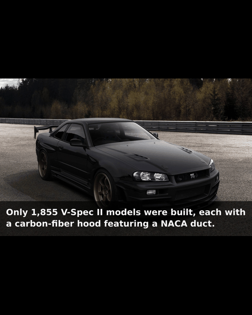
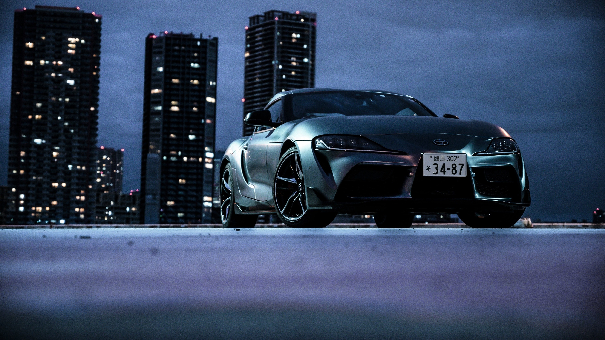
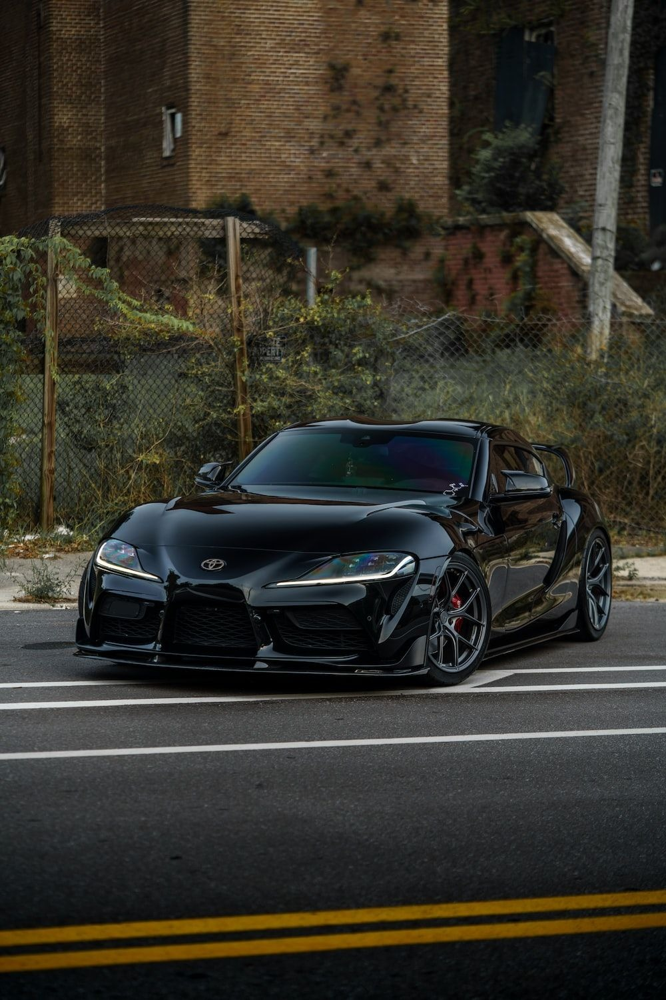
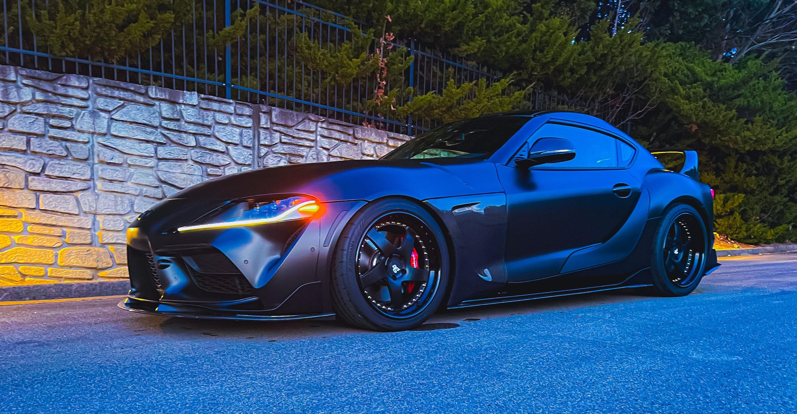
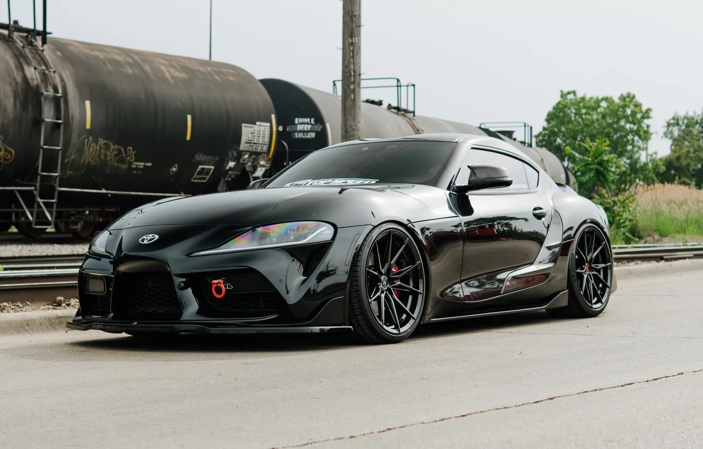
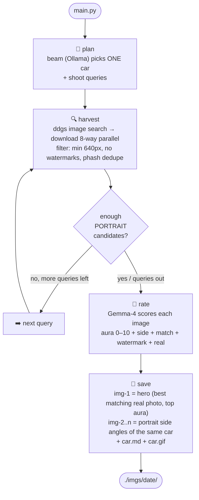
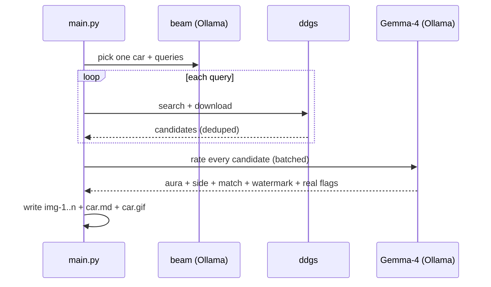

# Car Aura Collector

A **LangGraph** agent that picks one car, hunts its photoshoot across the web, lets **Gemma-4 (Ollama Cloud)** rank every candidate by *aura*, and writes the best 10 as `./imgs/{date}/img-{n}.jpg`, a `car.md` spec sheet and a looping `car.gif` of the whole set.

| Hero (best aura, any ratio) | Side angles (mobile/portrait) |
|---|---|
|  |  |
|  |  |

> Every run is **one car, one shoot, zero duplicates, zero fakes** — perceptual hashing throws out repeats, and Gemma-4 rejects anything AI-generated, rendered or watermarked before it can be saved.

## How it works



### Selection pipeline

```mermaid
flowchart LR
    A[raw web images] --> B{watermarked<br/>domain?}
    B -- yes --> X[drop]
    B -- no --> C{min 640×400<br/>not a crazy crop?}
    C -- no --> X
    C -- yes --> D{phash within<br/>4 bits of a<br/>kept image?}
    D -- yes --> X
    D -- no --> E[Gemma-4:<br/>aura + side + match<br/>+ watermark + real?]
    E --> F[non-real (AI/render) dropped<br/>hero = max aura, match first<br/>sides = portrait first<br/>watermarked sink to the back]
    F --> G[imgs/date/img-n.jpg<br/>+ car.md + car.gif]
```

## Install

```bash
git clone <repository-url> && cd image-collector
python -m venv .venv
.venv/bin/pip install -r requirements.txt   # langgraph, ddgs, requests, pillow
```

No API keys are required for image search (DuckDuckGo). Planning and rating use Ollama Cloud.
Create a local `.env` from the included template, or export the variable in your shell:

```bash
cp .env.example .env
# edit .env and set OLLAMA_API_KEY
```

Never commit `.env` or paste a real API key into source files. If a key is exposed,
revoke it immediately in Ollama Cloud and create a replacement.

## Usage

```bash
# today's shoot, 10 images (defaults)
.venv/bin/python main.py

# pick the date and how many images you want
.venv/bin/python main.py --date 2026-11-08 --target 10

# browse the archive in a browser
.venv/bin/python app.py --port 5050
```

Real run output (one example — cars vary between runs; this run fell back to the Supra):

```text
Collecting 10 images of one car into ./imgs/2026-11-08/ ...
  planner car planning failed (empty answer); using fallback: Toyota Supra GR
shoot: black Toyota Supra GR (A90 GR)
[1/11] 'Toyota Supra A90 black photoshoot': 25 urls
  accepted 16 candidates (target 10)
[2/11] 'GR Supra night photography': 24 urls
  accepted 36 candidates (target 10)
  ...
rater (gemma4) scoring 68 images...
  best aura=9 portrait=False side=True
  dropped 33 AI-generated / rendered / non-real candidates
  note: only 2 matching portrait sides, filled to 10 with best remaining angles
  saved .../img-1.jpg  aura=9 side=True match=True real=True watermark=False
  ...
  wrote imgs/2026-11-08/car.md
  wrote imgs/2026-11-08/car.gif (10 frames)
Done: 10/10 images in ./imgs/2026-11-08/
```

### Output layout

```text
imgs/
└── 2026-11-08/
    ├── img-1.jpg     ← hero shot: highest aura, any aspect ratio
    ├── img-2.jpg     ← side angles of the same car: portrait / mobile aspect first
    ├── ...
    ├── img-10.jpg
    ├── car.md        ← spec sheet of the car in this shoot
    └── car.gif       ← every saved image, looping (900ms per frame)
```

`car.md` looks like:

```markdown
name: 911 GT3 RS
company: Porsche
version: 992.1
variant: RS
color: black
year: 2023
engine: 4.0L naturally aspirated flat-six
power: 518 hp
drivetrain: RWD, 7-speed PDK
description: Track-focused 911 with a huge swan-neck rear wing.
```

## The agents

| Stage | Who | What it decides |
|---|---|---|
| **Plan** | Ollama Cloud `beam` (`/v1/chat/completions`) | which car to shoot + its search queries |
| **Harvest** | DuckDuckGo (`ddgs`) | which images exist, which are big enough / clean / not duplicates |
| **Rate** | Gemma-4 via Ollama Cloud (`/v1/chat/completions`) | `aura` (0–10), side angle, same-car `match`, burned-in `watermark`, and `real` (rejects AI/renders/video-game shots) |



## Files

| File | Role |
|---|---|
| `main.py` | CLI entry (`--date`, `--target`) |
| `workflow.py` | LangGraph `StateGraph`: plan → harvest → rate → save (`img-*.jpg` + `car.md` + `car.gif`) |
| `planner.py` | car planner using Ollama model `beam` (5-car random fallback pool on failure) |
| `image_search.py` | ddgs search, download, quality filters, watermark + AI-site blocklist, perceptual-hash dedupe |
| `rater.py` | Gemma-4 vision scoring (aura + side-angle + same-car match + watermark + real-photo flags), batched with retries |
| `test_score.py` | self-check: filters, dedupe, portrait flag |
| `test_graph.py` | offline end-to-end graph test (monkeypatched network) |

## Tests

```bash
.venv/bin/python test_score.py   # ok: assess + dedupe
.venv/bin/python test_graph.py   # ok: plan->harvest->rate->save, real+watermark-free hero+sides+fill+car.md+car.gif
```

## Notes

- Runs on your machine by default; production domain is documented in the Gallery web app section.
- DuckDuckGo rate-limits aggressively: the harvest node sleeps between queries and retries on429s.
- Not enough portrait shots? The saver fills the shortfall with the best remaining angles and prints a note, so you always get `--target` images.
- **Real photos only**: Gemma-4 flags every candidate as `real` (photo) or not (AI / 3D render / video-game shot) and non-real images are dropped before saving; AI-art sites (civitai, midjourney, leonardo.ai, …) are also blocked at search time.
- **A different car every run**: Ollama model `beam` picks the car + queries; if `beam` fails or returns unusable JSON, a random car from a 5-car fallback pool (Porsche GT3 RS, Nissan GT-R Nismo, BMW M4, Lamborghini Huracán, Toyota Supra) is used — never always the same Porsche.

## Gallery web app — Vista Cars

**Live demo:** https://vistacars.thetrillioniar.me

A small Flask app serves the archive everywhere: every shoot under `./imgs/<date>/`, plus every GIF in `./assets/`. It is installed with the same virtualenv:

```bash
.venv/bin/pip install -r requirements.txt   # includes flask
.venv/bin/python app.py --port 5000        # or --port 5057 if 5000 is taken
# open http://127.0.0.1:5000
```

| Page | URL | What it shows |
|---|---|---|
| Archive | `/` | latest shoot hero, stats, all shoots, motion reel, pipeline |
| Shoot detail | `/shoot/<date>` | spec sheet, description, lightboxed frame grid, prev/next shoots |
| Motion | `/motion` | auto-detected shoot `car.gif` loops plus allowed `*.gif` loops from `assets/` (`demo.gif` is excluded) |
| Shoot JSON | `/api/shoots/<date>` | shoot + car metadata + image list |
| Health | `/healthz` | `{"ok": true}` |


Files added for the app: `app.py`, `templates/` (base, index, shoot, motion, 404), `static/css/style.css`, `static/js/app.js`, `static/favicon.svg`, plus `LICENSE` (personal use only; no corporate or commercial use).

- **Hero demo gif** — every `create.py` run rebuilds `assets/demo.gif` from that shoot's final images, so README's top-of-page GIF leads the latest batch. Pass `--no-demo` to keep the current hero.
